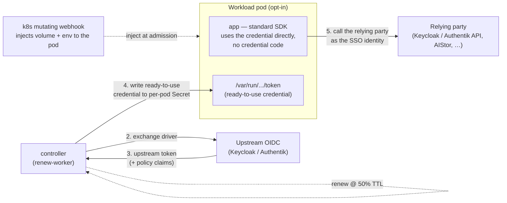

# k8s-oidc-bridge

**Give every pod a short‑lived, SSO‑issued identity — no static secrets, no per‑app code.**

[](./LICENSE)


k8s-oidc-bridge turns a pod's **Kubernetes ServiceAccount** into an identity from your **SSO**
(**Keycloak, Authentik, …**), **auto‑renews** it, and **transparently injects it as a ready‑to‑use
token**. The pod can then call an API **as that SSO service account** — including your SSO's own
Admin API — or present the token as a **Web Identity Token** to AWS‑SigV4 services like **AIStor
(formerly MinIO)**. No static keys, and usually no application code.

## Why

For years the industry has steadily worked to **kill static credentials** — leaning on a single
identity authority and federated authentication. It's now routine for a **GitHub Actions** run to
authenticate to **AWS** with its OIDC runner identity (no stored keys), and for a **Kubernetes
workload** to reach **AWS or GCP** through its ServiceAccount via workload identity / IRSA.

But that convenience hasn't reached everywhere. Plenty of **third‑party services speak OIDC yet still
can't consume a Kubernetes ServiceAccount token transparently** — even after you wire up a trust
relationship. The cluster issuer may be untrusted (another cluster, on‑prem, a SaaS, or a claim‑based
provider that allows only one), or a raw SA token simply **can't carry the custom claims** (policy,
groups, tenant) the service needs for per‑principal authorization.

k8s-oidc-bridge closes that gap: it **exchanges the pod's ServiceAccount token for an OIDC token the
third party accepts** and injects it into the pod — so the workload authenticates and uses the service
directly, with no static credentials. One declarative resource handles the exchange, renewal, and
delivery.

## Example

Say you have a Keycloak client **`internal-hr-tool`** whose service account may read the realm
(e.g. the `view-users` role). Give its pods that identity using only a Kubernetes ServiceAccount —
no client secret anywhere.

**1. Declare it once** — bind the ServiceAccount to the Keycloak client:

```yaml
apiVersion: bridge.oidc.io/v1alpha1
kind: TokenBinding
metadata:
  name: internal-hr-tool
  namespace: hr
spec:
  serviceAccountName: internal-hr-tool-server   # the pod's k8s ServiceAccount
  providerRef: keycloak                          # resolves to the Keycloak client "internal-hr-tool"
  audience: https://sso.example/realms/corp/protocol/openid-connect/token
  projection:
    env:
      - name: OIDC_TOKEN_FILE
        valueFromTokenFile: true
```

**2. Your container just calls the API** — the bridge injects a short‑lived access token for the
`internal-hr-tool` service account; the app reads it and calls Keycloak's Admin API. **No client
secret, no `client_credentials` dance, no refresh code:**

```go
// main.go — runs as serviceAccountName: internal-hr-tool-server
import "github.com/Nerzal/gocloak/v13"                   // the common Go Keycloak SDK

kc := gocloak.NewClient("https://sso.example")

// The usual path needs a STATIC client secret: kc.LoginClient(ctx, clientID, clientSecret, realm).
// With the bridge there's no secret to store — you already hold a transparently issued,
// auto-renewed token:
token, _ := os.ReadFile(os.Getenv("OIDC_TOKEN_FILE"))   // ⟵ injected & rotated by the bridge

users, _ := kc.GetUsers(ctx, strings.TrimSpace(string(token)),
    "corp", gocloak.GetUsersParams{})                    // Admin API: list realm users
//  ▲ succeeds — acting as the internal-hr-tool Keycloak service account
```

> Illustrative: in production, cache the token and re‑read it only when it changes or nears expiry,
> rather than reading the file on every request.

```yaml
# deployment.yaml — note what's NOT here: no Secret, no client credentials
spec:
  template:
    spec:
      serviceAccountName: internal-hr-tool-server     # ⟵ the entire credential config
      containers:
        - name: hr-tool
          image: myorg/internal-hr-tool
```

That's the whole setup. The pod acts as the `internal-hr-tool` Keycloak service account —
short‑lived, auto‑renewed at 50 % TTL, with zero secrets in the app. The same token also works as a
**Web Identity Token** for AWS‑SigV4 services like **AIStor (formerly MinIO)**.

➡️ **[Getting started](./docs/getting-started.md)** · **[Examples](./examples)** — Keycloak, MinIO/AIStor

## How it works



Two stateless components, driven by the `TokenBinding` CRD:

- **controller** — mints the SA token, runs a pluggable **exchange driver** (`rfc8693`,
  `oidc-jwt-bearer`, `client-assertion`, …) against your SSO, writes a per‑pod Secret, and renews at
  50 % TTL. Leader‑elected, Prometheus metrics, Kubernetes Events.
- **webhook** — in opt‑in namespaces, resolves a pod's ServiceAccount to its `TokenBinding` and
  injects the token as a read‑only volume + web‑identity env. HA, fail‑closed with
  deadlock‑avoidance safeguards.

> **Not an IdP.** The bridge never signs tokens or decides claim *values* — your SSO does. It only
> drives the **exchange → renew → deliver** plane.

## How it compares

**SPIRE and Vault are excellent at what they're built for** — SPIRE as a full workload‑identity
platform, Vault as a secrets and brokering platform. This table isn't a knock on them; it's here to
help you decide when you *don't* need all that, and just want to reuse your existing SSO as the
identity authority and deliver its token to pods.

| | k8s-oidc-bridge | SPIRE | Vault | Direct OIDC federation |
|---|---|---|---|---|
| Uses *your existing SSO* as the authority | ✅ | ✖ (its own CA/SVID) | ~ (Vault as broker) | ✖ (relying party trusts cluster) |
| Works when the relying party can't trust the cluster issuer | ✅ | ~ | ✅ | ✖ |
| Per‑principal claims from the relying party's existing provider | ✅ | ~ | ~ | ✖ |
| Transparent to the app (no sidecar, no SVID API) | ✅ (webhook inject) | ✖ (needs `spiffe-helper`) | ~ (agent) | ✅ |
| Scope | this one problem, small | full workload‑identity platform | full secrets platform | built‑in, limited |

Use direct OIDC federation when your relying party *can* trust the cluster issuer — it's simpler.
Reach for k8s-oidc-bridge when it can't, or when you want one SSO to be the identity authority across
clusters.

## Status

**Alpha.** Core exchange → renew → deliver is verified end‑to‑end (Authentik → MinIO/AIStor).
Deliberately a *thin exchange plane* — **not** an identity provider, a secrets manager, or a policy
engine. Roadmap and scope: [docs/getting-started.md](./docs/getting-started.md#roadmap).

## Docs

- [Getting started](./docs/getting-started.md) — install, configure a provider, bind a ServiceAccount, verify.
- [Examples](./examples) — MinIO/AIStor and Keycloak recipes.
- [Contributing](./CONTRIBUTING.md) · [Architecture Decision Records](./docs/adr)

## License

[Apache License 2.0](./LICENSE) — free for any use, including commercial, with an explicit patent grant.
